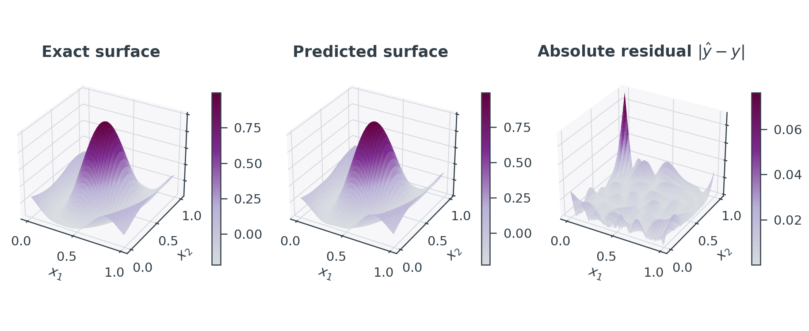
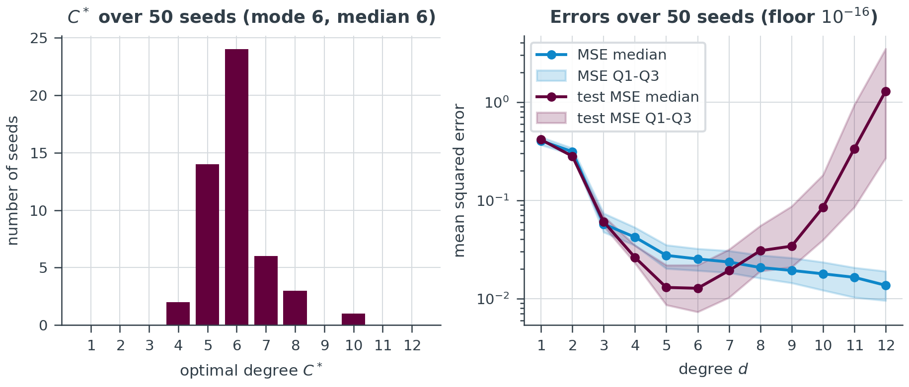
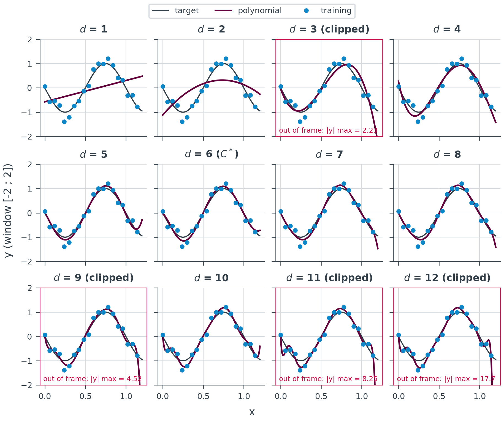
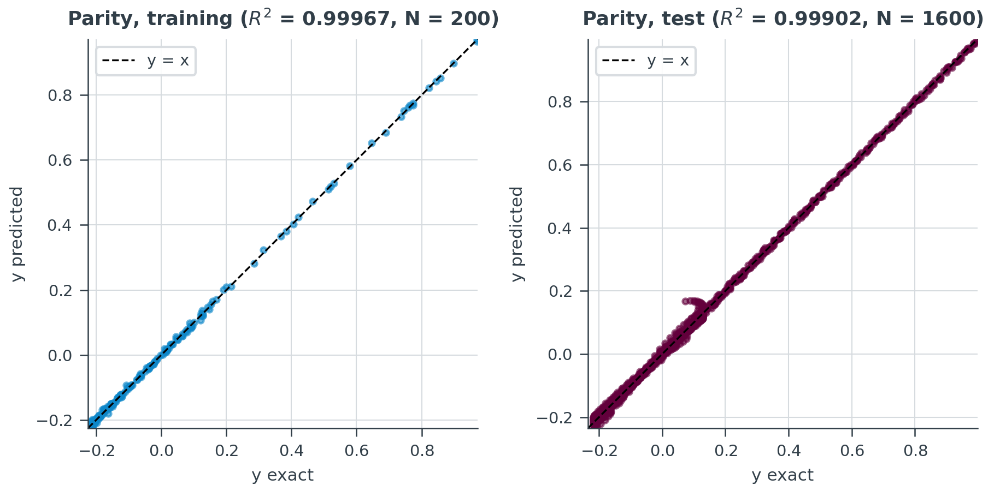

# Polynomial regression and MLP surface approximation

A scientific Python study with two parts: a numerical comparison of three least-squares solvers for one-dimensional polynomial regression, and a protocol-driven study of multilayer perceptrons (MLPs) approximating a two-dimensional surface. Every figure and table is regenerated by code and can be checked byte for byte with one command.



*Exact surface, prediction and absolute residual of the final network on a 200 x 200 rendering grid. One network out of 10 seeded runs (seed 1819), not representative of the configuration.*

## What this project shows

- **1D polynomial regression.** Normal equations, QR and SVD are implemented on an uncentred Vandermonde matrix and compared on conditioning and accuracy, then used to study overfitting, noise level, sample size and extrapolation (50 noise seeds per setting).
- **2D MLP regression.** 19 configurations x 10 seeds (190 trained networks) cover width, depth, activation, L2 regularisation and optimiser. Configurations are chosen on a validation grid only; the test grid is read once, after the selection is frozen and hashed.

## Key results

| Final test configuration (10 seeds, 1600 test points) | Mean MSE | Mean R² |
| --- | ---: | ---: |
| L-BFGS, tanh, (50, 25) | 0.000248148 | 0.996690 |
| L-BFGS, tanh, (50,) | 0.000390529 | 0.994790 |
| Adam, (50,), learning rate 0.01, batch 200 | 0.005663575 | 0.924446 |

Source: `results/tables/mlp_2d_final_summary.csv` (generated by `make figures`). These are descriptive statistics over 10 seeds for this data set, not confidence intervals and not an external benchmark.

- In the 50-seed nominal polynomial experiment (20 noisy points, sigma = 0.2), mean training error falls from 0.406 (degree 1) to 0.0148 (degree 12) while mean test error is smallest at degrees 5 and 6 (0.0153 and 0.0163) and reaches 2.39 at degree 12. Source: `results/tables/nominal_1d_stats_50_seeds.csv`.
- For the noise seed 42, the relative gap between the normal-equations and SVD solutions grows from 1.0e-15 (degree 1) to 0.85 (degree 12) as kappa(HᵀH) reaches 5.3e17, while QR stays below 3.5e-14. Source: `results/tables/nominal_1d_seed42_diagnostics.csv`.







## Methods at a glance

- **Polynomial solvers:** normal equations (HᵀH)β = Hᵀy, QR with triangular back-substitution, and SVD least squares (minimum-norm solution for rank-deficient systems). Normal equations square the condition number: κ(HᵀH) = κ(H)².
- **Model choice in 1D:** the degree minimising the test error, C*, is a measured quantity whose error estimate is optimistically biased because it is chosen on the test set; the project reports its distribution over 50 seeds.
- **MLP:** scikit-learn `MLPRegressor`, tanh or ReLU, L-BFGS or Adam, L2 penalty; widths 5 to 200 and two-layer networks (20, 10) and (50, 25); 10 Monte Carlo seeds per configuration.
- **Protocol:** training on 200 input observations, selection on a 20 x 20 validation grid, final evaluation on a 40 x 40 test grid, with the selection stored in `results/tables/mlp_2d_selection.json` before the test set is read.

Details: [methods](docs/methods.md), [experiments](docs/experiments.md), [results](docs/results.md).

## Engineering highlights

- Strict separation of training, validation and test data, with the selection frozen and hashed before the final evaluation (`src/experiments/final_evaluation_2d.py`).
- A cache of 190 trained-network records (`data/processed/mlp_2d_runs/`), one JSON file per run keyed by a SHA-256 run identity, with weight fingerprints that the final evaluation re-checks after retraining.
- Deterministic exports: figures are written without creation dates, and `python main.py verify` regenerates tables and figures and compares them byte for byte; a manifest records the SHA-256 of every artefact.
- A test suite of 657 tests, including small MLP trainings.
- Pinned dependencies and a single BLAS thread for reproducible numerical results.

## Quick start

Use Python 3.12 and a virtual environment:

```sh
python -m venv .venv
. .venv/bin/activate
python -m pip install -r requirements.txt
make test
```

| Target | Effect |
| --- | --- |
| `make figures` | Builds `results/` (tables, figures, manifest) from the cache of trained networks, without training, and refreshes `assets/`. The final evaluation is computed on the first run, after the selection freeze has been verified. |
| `make test` | Runs the complete test suite (builds `results/` first if it is absent). |
| `make repro` | Regenerates everything in a temporary directory and compares it byte for byte with `results/`. |
| `make all` | `figures`, `test` and `repro`. |
| `make clean` | Removes `results/`, caches and the manifest. |

`results/` is not versioned: it is regenerated locally. Set the interpreter with `make PYTHON=/path/to/python`. Full retraining of the 190 networks is available with `python main.py reproduce --full --out DIR` and must be requested explicitly.

## Repository layout

- `src/data/`: 1D and 2D data generation and loading.
- `src/models/`: polynomial solvers and MLP training.
- `src/experiments/`: 1D and 2D runners and the final evaluation.
- `src/export/`: artefact registry, derived tables, manifest, static checks and export pipeline.
- `src/visualization/`: figure style and plotting code.
- `src/utils/`: metrics, seeding and logging.
- `tests/`: scientific and technical checks.
- `data/raw/`: input observations. `data/processed/`: cache of trained-network records.
- `assets/`: showcase figures regenerated by `make figures`. `results/`: generated tables and figures (ignored by Git).
- `main.py`: verification, export and reproduction entry point.

See [architecture](docs/architecture.md) and [reproducibility](docs/reproducibility.md).

## Limitations

- Results are specific to the supplied data set and to the synthetic experiments described here.
- Statistics over 10 or 50 seeds are descriptive, not confidence intervals.
- The 1D optimal degree is selected on the test set, so its error is optimistic.
- Adam runs often stop on the iteration budget (warnings in 5, 10, 6 and 10 of 10 runs for the four grid settings); L-BFGS runs in the final evaluation raised no warning.
- Default verification does not rebuild the networks behind the parity and surface plots unless `--with-models` is given. Runtime measurements depend on the environment.
- Reproducibility is established on one host and one BLAS thread. No cross-platform bitwise guarantee is made.

## License and attribution

Original code is licensed under the MIT License, copyright (c) 2026 Mehdi Bouama; see [LICENSE](LICENSE). Data and third-party software are attributed in [NOTICE](NOTICE); the code license does not apply to the data file.
