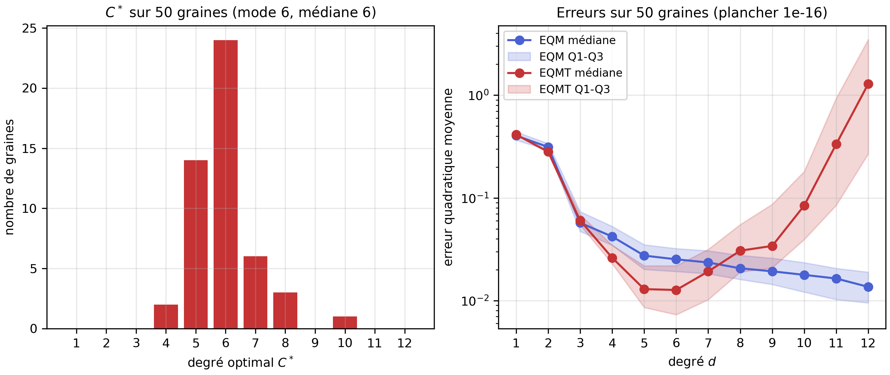
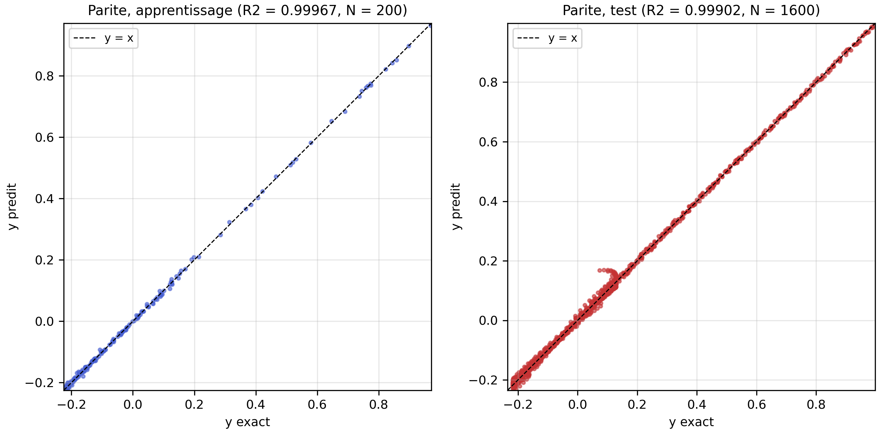

# Polynomial regression and MLP

## Overview

A scientific Python study of one-dimensional polynomial regression and two-dimensional function approximation with multilayer perceptrons. The repository includes experimental tables, figures and a frozen record of 190 MLP runs.

## Mathematical Methods

For a Vandermonde design matrix H, the implementation compares normal equations (HᵀH)β = Hᵀy, QR factorization with triangular solution, and SVD least squares. Normal equations square the condition number and can amplify numerical errors. QR and normal equations require full column rank; SVD also handles underdetermined or rank-deficient systems with a minimum-norm solution.

## Polynomial Regression

Polynomial least squares is studied using ordinary least squares, QR and singular value decomposition. Experiments examine polynomial degree, noise, sample size and extrapolation. The 2D study compares MLP topology, activation, regularisation and solvers, using validation to select configurations before final test evaluation. Multiple seeds quantify variability.

## Multilayer Perceptron Regression

The frozen study covers 19 distinct configurations with 10 seeds each. Single hidden layers use 5, 10, 20, 50, 100 or 200 units; two-layer networks use (20, 10) and (50, 25). Sensitivity experiments compare tanh and ReLU, L2 regularization, L-BFGS and Adam. Configurations are selected using validation error; the held-out test set is used for final evaluation.

## Experimental Results

In the 50-seed nominal polynomial experiment, training error decreases with degree while mean test error rises substantially at high degrees, illustrating overfitting for this setup. In the frozen 2D evaluation, the selected tanh L-BFGS network with layers (50, 25) has mean test MSE 0.000248 across the recorded runs. These are results for the specific experimental settings, not general performance guarantees. See `results/tables/` for the full measurements and `results/figures/` for the corresponding plots.

| Final test configuration | Mean MSE | Mean R² |
| --- | ---: | ---: |
| L-BFGS, tanh, (50, 25) | 0.000248148 | 0.996690 |
| L-BFGS, tanh, (50,) | 0.000390529 | 0.994790 |
| Adam, (50,), learning rate 0.01, batch 200 | 0.005663575 | 0.924446 |

Source: `results/tables/mlp_2d_final_synthese.csv`. These aggregates use the recorded final test runs, not an independent external benchmark.





## Project Structure

- `src/`: models, experiments, evaluation and export.
- `tests/`: scientific and technical checks.
- `data/raw/`: input data.
- `data/processed/`: frozen MLP runs and export manifest.
- `results/`: frozen tables and figures.
- `main.py`: verification and export entry point.

## Installation

Use Python 3.12 and a virtual environment:

```sh
python -m venv .venv
. .venv/bin/activate
python -m pip install -r requirements.txt
```

## Usage

```sh
python main.py --help
python main.py verify
```

Verification reads the frozen cache and compares regenerated exports. It does not regenerate network-dependent figures unless `--with-models` is specified; that option reconstructs networks and is not needed for the cache-only check. Full reproduction trains models and must be requested explicitly with `reproduce --full`.

## Testing

```sh
OMP_NUM_THREADS=1 OPENBLAS_NUM_THREADS=1 python -m pytest -q --no-mlp-training
```

The documented test mode skips tests at the point they would optimize an MLP. Other scientific and technical tests still run. The complete suite (`python -m pytest -q`) includes small MLP training tests; use it only when training is intended. Neither mode automatically reruns the frozen 190-run campaign.

## Reproducibility

The reference environment uses Python 3.12.3 and the pinned packages in `requirements.txt`, with one BLAS thread. Cache identity includes software versions, model source and thread count. Exact reproduction across platforms or different library versions is not established. The export manifest records artifact hashes. Default verification does not regenerate network-dependent figures; these are reported as NOT RUN.

## Limitations

Results are specific to the supplied dataset and synthetic experiments. Default verification does not reconstruct the networks behind the parity and surface plots. Runtime measurements are environment dependent. No cross-platform bitwise guarantee is made.

## License & Data Attribution

Original code is licensed under the MIT License, copyright (c) 2026 Mehdi Bouama; see [LICENSE](LICENSE). `data/raw/sinc_dim2_input.csv` originates from a CEA course resource. It is included by the repository owner’s explicit decision. No institutional redistribution authorization is claimed. The code license does not automatically apply to third-party data or other third-party materials.
