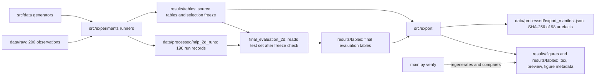

# Architecture

## Package layout

| Package | Modules | Role |
| --- | --- | --- |
| `src/data/` | `generator_1d.py`, `generator_2d.py`, `data_loader.py` | 1D target and noisy sampling; 2D target, validation and test grids; loading of the reference 2D observations without synthetic substitution |
| `src/models/` | `polynomial.py`, `mlp.py` | Vandermonde matrix and the three least-squares solvers with conditioning diagnostics; MLP configuration, training and repeated runs |
| `src/experiments/` | `runner_1d_nominal.py`, `runner_1d_explorations.py`, `runner_2d_nominal.py`, `runner_2d_parametric.py`, `final_evaluation_2d.py` | Experiment drivers; the 2D runners manage the run cache, the sensitivity studies, the selection on validation and its freeze; the final evaluation is the module that reads the test set |
| `src/export/` | `registry.py`, `build.py`, `latex_tables.py`, `checks.py`, `layout.py`, `pipeline.py` | Declarative list of exported artefacts; construction of derived tables, figure metadata, preview and manifest; CSV to LaTeX formatting; read-only checks; file layout parametrised by a root directory; production and comparison of artefacts |
| `src/visualization/` | `style.py`, `plots_1d.py`, `plots_1d_explorations.py`, `plots_2d.py` | Common figure style and single export function; 1D, exploration and 2D figures, separated from computation |
| `src/utils/` | `metrics.py`, `seeding.py`, `logger.py` | Error metrics and condition numbers; explicit seeds without global random state; structured logging in JSON Lines |
| `main.py` | | Command-line entry point for `verify`, `export` and `reproduce` |

## Data flow

Source tables are written by the experiment runners. The export pipeline never rewrites them: it writes only derived artefacts (figures, LaTeX fragments, derived CSV files, figure metadata, preview and manifest) and refuses to run when a source table has drifted.

## Design choices

- **No global random state.** Every source of randomness receives an explicit generator or an integer seed.
- **Computation and plotting are separate.** Runners write tables; figure modules read them.
- **Export root is a parameter.** The same code writes into the repository, a temporary directory for `verify`, or an isolated directory for `reproduce`, which is what allows byte-for-byte comparison without touching the repository.
- **Cache with explicit identity.** A run record is valid only if its stored identity hashes to its file name; mismatching records are reported as errors.
- **Test set isolation.** Only the final evaluation module (and the figure code behind `--with-models`, after the same checks) reads the test grid.

## Tests

The `tests/` directory contains 690 collected tests, organised by area:

- **Data and metrics:** 1D and 2D data generation, error metrics, seeding and logging.
- **Models:** the polynomial solvers (known polynomials, agreement by conditioning regime, rank-deficient and underdetermined systems, error cases) and the MLP pipeline.
- **Experiments:** the nominal and exploration experiments in 1D, the 2D experiments and the selection logic, including tests that independently recompute the selection from validation records and the test metrics against a NumPy oracle.
- **Figures:** figure construction in 1D and 2D.
- **Export:** table formatting, injected defects for the static checks, source-table drift, cache identity and the export pipeline.

`tests/conftest.py` provides the `--no-mlp-training` option described in [reproducibility](reproducibility.md).
