# Results

All values below are copied from the frozen tables in `results/tables/`; the source file is named next to each table. They describe the specific experiments in [experiments](experiments.md) and are not general performance guarantees. Statistics over 10 or 50 seeds are descriptive, not confidence intervals. Figure annotations are in French, the language of the original study.

## 1. One-dimensional polynomial regression

### Nominal experiment, 50 noise seeds

Setting: $N = 20$, $\sigma = 0.2$, seeds 1000 to 1049. Source: `nominal_1d_stats_50_graines.csv` and `nominal_1d_cstar_50_graines.csv`.

| Degree | Mean EQM (train) | Mean EQMT (test) | Median EQMT | Seeds with $C^\*$ = degree |
| ---: | ---: | ---: | ---: | ---: |
| 1 | 0.4063 | 0.4159 | 0.4140 | 0 |
| 2 | 0.3205 | 0.2828 | 0.2812 | 0 |
| 3 | 0.06117 | 0.06327 | 0.06030 | 0 |
| 4 | 0.04382 | 0.02963 | 0.02618 | 2 |
| 5 | 0.02923 | 0.01527 | 0.01296 | 14 |
| 6 | 0.02725 | 0.01635 | 0.01271 | 24 |
| 7 | 0.02512 | 0.02363 | 0.01923 | 6 |
| 8 | 0.02279 | 0.03790 | 0.03066 | 3 |
| 9 | 0.02106 | 0.05624 | 0.03411 | 0 |
| 10 | 0.01909 | 0.1378 | 0.08446 | 1 |
| 11 | 0.01687 | 0.6217 | 0.3343 | 0 |
| 12 | 0.01480 | 2.389 | 1.291 | 0 |

Training error decreases with the degree, while test error is smallest around degrees 5 and 6 and then grows quickly, which is the usual overfitting pattern for this setting. The optimal degree $C^\*$ is 6 in 24 of the 50 seeds and 5 in 14. Since $C^\*$ is chosen on the test set, its test error is optimistic.

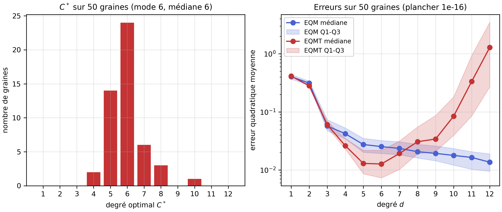

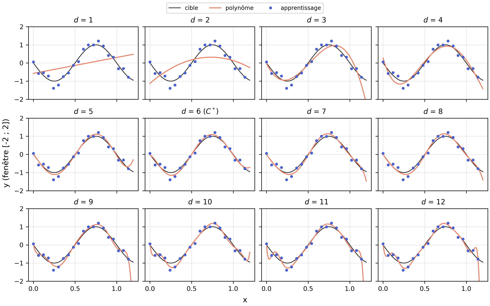

*Seed-42 fits. Panels outlined in red have a polynomial leaving the plotting window; the annotation gives the maximum absolute value.*

### Solver comparison and conditioning, seed 42

Source: `nominal_1d_seed42_diagnostics.csv`. Gaps are relative differences to the SVD solution.

| Degree | $\kappa(H^\top H)$ | Regime | Normal equations vs SVD | QR vs SVD |
| ---: | ---: | --- | ---: | ---: |
| 1 | 1.5e+01 | strict | 1.0e-15 | 1.3e-16 |
| 3 | 8.5e+03 | strict | 6.7e-14 | 8.4e-16 |
| 5 | 6.2e+06 | strict | 2.5e-12 | 9.5e-16 |
| 6 | 1.8e+08 | diagnostic | 4.7e-10 | 7.5e-16 |
| 8 | 1.9e+11 | diagnostic | 1.7e-06 | 2.2e-15 |
| 10 | 2.7e+14 | diagnostic | 3.2e-03 | 2.3e-14 |
| 12 | 5.3e+17 | diagnostic | 0.85 | 3.4e-14 |

The gap of the normal equations grows with $\kappa(H^\top H)$ and reaches 0.85 at degree 12, whereas QR stays below $3.5 \times 10^{-14}$ over all degrees.

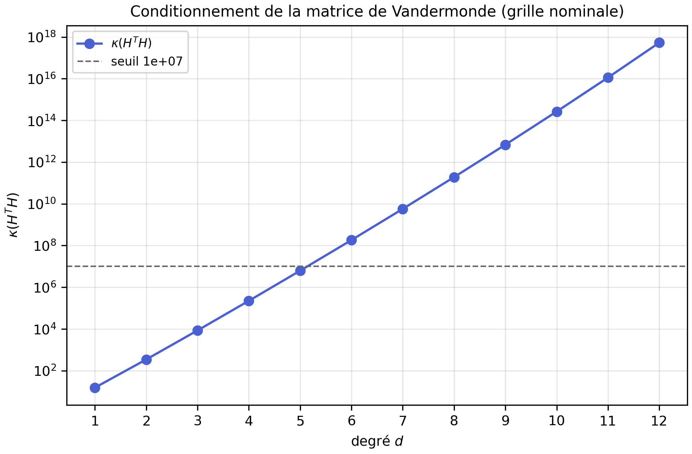

### Explorations

Sample size ($\sigma = 0.2$, 50 seeds each). Source: `exploration_nb_ex_synthese.csv`.

| $N$ | Most frequent $C^\*$ | Lowest median EQMT | Median EQMT at degree 12 |
| ---: | ---: | ---: | ---: |
| 10 | 5 | 0.05234 | 390.6 |
| 15 | 5 | 0.02003 | 94.14 |
| 20 | 6 | 0.01271 | 1.291 |
| 50 | 6 | 0.004833 | 0.01162 |
| 100 | 6 | 0.002440 | 0.004746 |
| 200 | 6 | 0.001515 | 0.002422 |

Noise level ($N = 20$, 50 seeds each, except one realisation for $\sigma = 0$). Source: `exploration_sigma_synthese.csv`.

| $\sigma$ | Most frequent $C^\*$ | Lowest median EQMT | Median EQMT at degree 12 |
| ---: | ---: | ---: | ---: |
| 0 | 12 | 6.7e-11 | 6.7e-11 |
| 0.05 | 6 | 9.83e-04 | 0.0807 |
| 0.1 | 6 | 3.27e-03 | 0.3228 |
| 0.2 | 6 | 1.27e-02 | 1.291 |
| 0.5 | 5 | 7.40e-02 | 8.07 |
| 1.0 | 3 | 0.1882 | 32.28 |

More data reduces the penalty of high degrees, and more noise moves the best degree downwards.

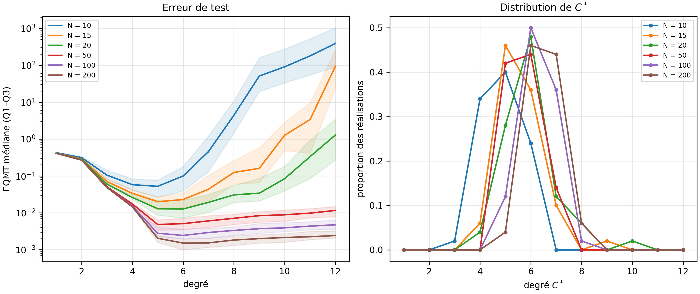

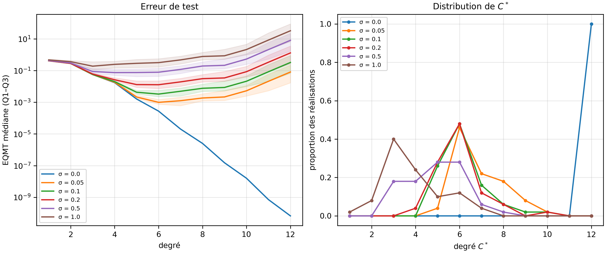

Extrapolation on $[-0.3, 1.5]$ (50 seeds). Median errors inside and outside the training domain $[0, 1.2]$. Source: `exploration_extrapolation_stats.csv`.

| Model | Median error inside | Median error outside |
| --- | ---: | ---: |
| degree 1 | 0.4212 | 1.720 |
| degree 3 | 0.0675 | 19.74 |
| $C^\*$ | 0.0116 | 19.21 (mean 1096) |
| degree 10 | 0.1273 | 1.17e+05 |

The median error outside the training domain is larger than inside for every model, and the mean for $C^\*$ (1096) is far above its median, which shows a few very large errors.

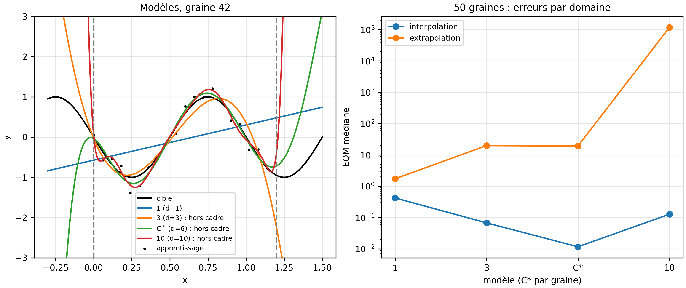

## 2. Two-dimensional MLP regression

### Validation results, 10 seeds per configuration

Sources: `mlp_2d_configurations.csv`, `mlp_2d_hstar.json`, `mlp_2d_adam_grid.csv`.

Width (tanh, L-BFGS, $\alpha = 10^{-4}$):

| Hidden units | Mean validation MSE |
| ---: | ---: |
| 5 | 0.01276 |
| 10 | 0.001532 |
| 20 | 0.000456 |
| **50 ($H^\*$)** | **0.0002445** |
| 100 | 0.0002738 |
| 200 | 0.0004428 |

Depth, activation, regularisation and optimiser (width 50 unless stated):

| Configuration | Mean validation MSE |
| --- | ---: |
| two layers (20, 10), tanh, L-BFGS | 0.0001803 |
| **two layers (50, 25), tanh, L-BFGS (final configuration)** | **0.0001441** |
| ReLU, L-BFGS | 0.007476 |
| tanh, $\alpha = 10^{-5}$ | 0.000284 |
| tanh, $\alpha = 10^{-3}$ | 0.0002808 |
| tanh, $\alpha = 10^{-1}$ | 0.04473 |
| Adam, learning rate 0.001, batch 32 | 0.05135 |
| Adam, learning rate 0.001, batch 200 | 0.01955 |
| Adam, learning rate 0.01, batch 32 | 0.01035 |
| **Adam, learning rate 0.01, batch 200 (selected Adam)** | **0.004724** |

The validation error improves up to 50 hidden units and then degrades slightly. Two-layer networks and tanh are better than the single-layer and ReLU alternatives at this size, a strong penalty ($\alpha = 0.1$) hurts, and Adam with the given budget stays well behind L-BFGS. Warnings about the iteration budget occurred in 5, 10, 6 and 10 of the 10 Adam runs of the four grid settings, and in none of the L-BFGS runs of the final evaluation.

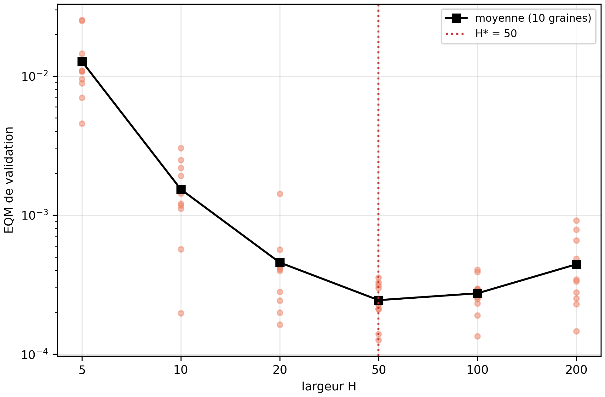

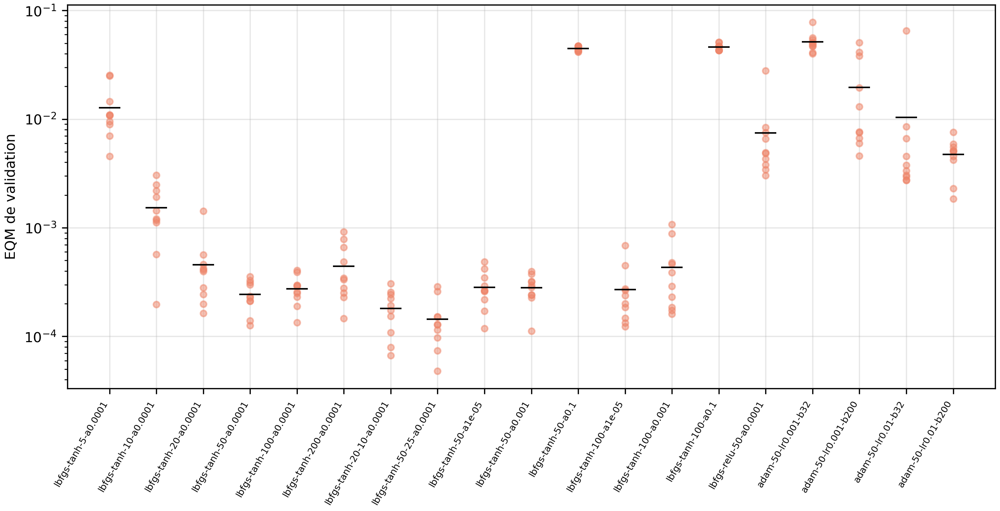

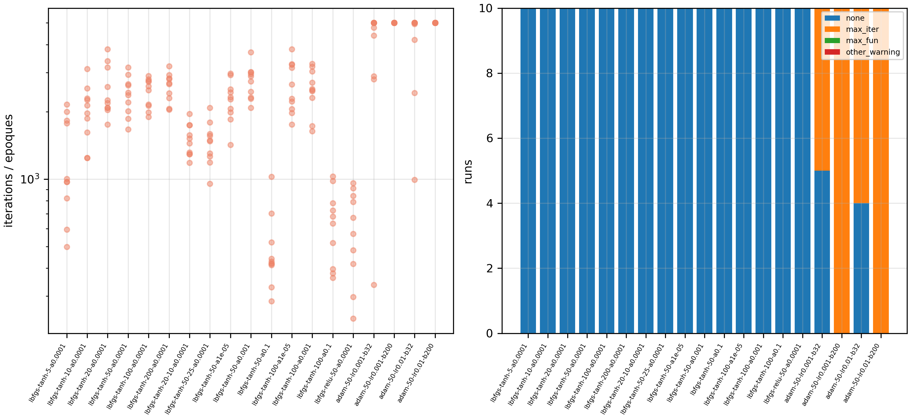

### Final test evaluation

Single evaluation on 1600 test points after the selection was frozen. Sources: `mlp_2d_final_synthese.csv` and `mlp_2d_solver_comparison.csv`.

| Role | Configuration | Mean test MSE | Std | Min | Max | Mean $R^2$ | Mean iterations |
| --- | --- | ---: | ---: | ---: | ---: | ---: | ---: |
| final | L-BFGS, tanh, (50, 25) | 2.481e-04 | 1.479e-04 | 7.378e-05 | 5.177e-04 | 0.99669 | 1471 |
| L-BFGS at $H^\*$ | L-BFGS, tanh, (50,) | 3.905e-04 | 1.321e-04 | 2.066e-04 | 6.195e-04 | 0.99479 | 2394 |
| selected Adam | Adam, tanh, (50,), learning rate 0.01, batch 200 | 5.664e-03 | 1.887e-03 | 2.446e-03 | 8.957e-03 | 0.92445 | 5000 |

The final configuration has the lowest mean test error of the three. Its mean test error is larger than its mean validation error (0.0001441), which is consistent with the configuration having been selected on the validation set. The plotted network is one of the 10 runs (seed 1819) and is not representative of the spread above.

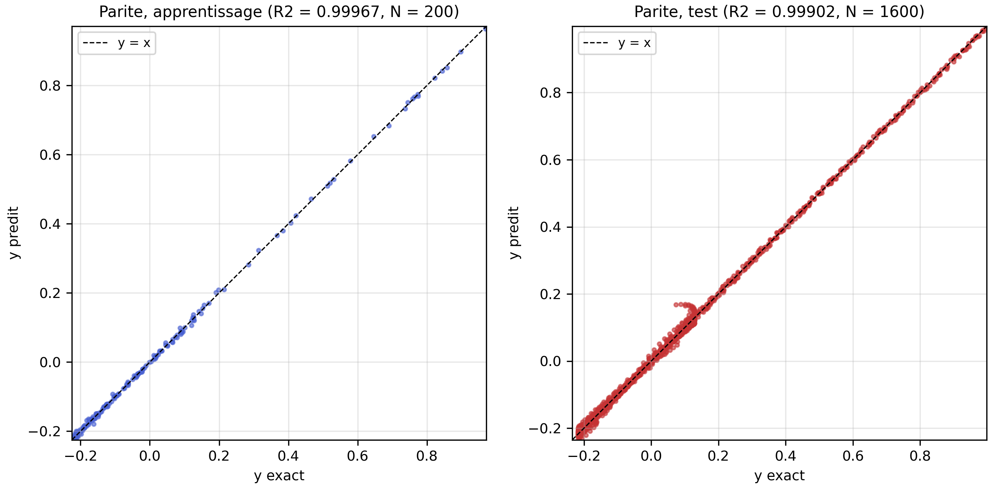

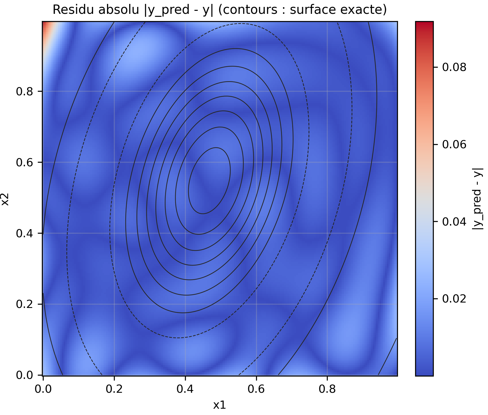

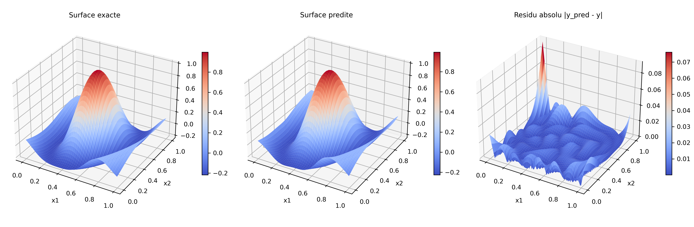
